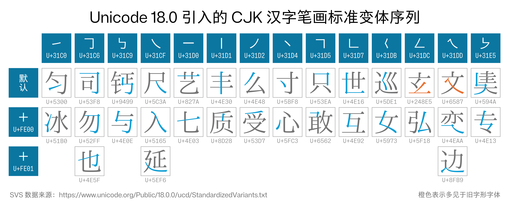
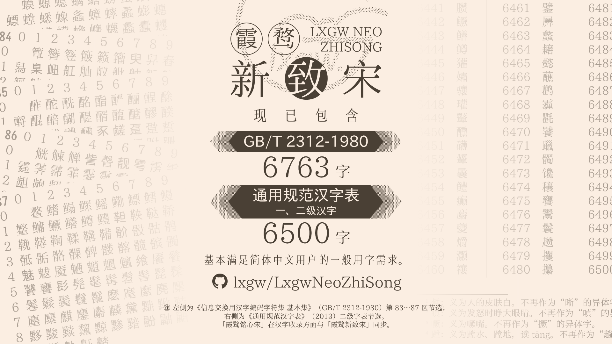

# 版本更新记录

## [v1.071] - 2026-11-10

- 新增汉字：𢓡
- 调整符号：▓
- 新增 CP437 符号：☺☻◘◙☼►◄▬↨⌐⌠⌡
- 根据 Unicode 18.0 的 G 源横扩，调整以下兼容汉字：益靖諸鶴禍

---

## [v1.070] - 2026-10-23

- 新增汉字：𡇌。

---

## [v1.069] - 2026-10-23

- 新增汉字：𭎜（铅～法）𨀁（～踵）。

---

## [v1.068] - 2026-10-22

- 新增汉字：𡵌𢵮𫄠𱷥𲋄。

---

## [v1.067] - 2026-08-20

- 新增汉字：𤒹𫛪。

---

## [v1.066] - 2026-07-14

- 新增汉字：𨨛𫋷𫓼；
- 对「⊞`U+229E」新增 U+1F7FC 码位映射；
- 调整 logo 的位置和宽度。

---

## [v1.065] - 2026-06-19

- 新增 Unicode 18.0 将引入的货币符号：⃂`U+20C2`、⃃`U+20C3`、⃄`U+20C4`；
- 新增汉字：𰹲𤟠𤟥𰛴𩿺𬸁𠹳𠆩𠆾𢒼𢓁𢓉𢓌𪛗𪛘𪛙𪛚𪛛𪛜𪛝𱝫𱝬𪻕。

---

## [v1.064] - 2026-05-26

- 新增 Unicode 18.0 引入的针对 CJK 汉字笔画的标准变体序列（SVS）：  
  
- 新增寒武纪符号 Ꞓ`U+A792` 及其小写 ꞓ`U+A793`。
- Plus 调整字形：㔯。

---

## [v1.063] - 2026-05-04

- 新增以下组合字形：Ŋ̄ŋ̄Ŋ́ŋ́Ŋ̌ŋ̌Ŋ̀ŋ̀（即汉语拼音 ng 简写的四声标调）。
- 以下为上个版本的更新内容：
  - 新增以下汉字：𫪩𫱖𧗩𠀾𠁞𲓖𤡯𡿒𳁩𥾺𧵈𨋌𩝎𫎓𮗻𮷍𲁰；
  - 新增即将于 Unicode 18.0 加入的下标 w、y、z（码位分别为 U+209D～U+209F），以及平假名 koto（U+1B123）、片假名 yori（U+1B126）；
  - 调整部分汉字字形。

---

## [v1.062] - 2026-05-03

- 新增以下汉字：𫪩𫱖𧗩𠀾𠁞𲓖𤡯𡿒𳁩𥾺𧵈𨋌𩝎𫎓𮗻𮷍𲁰；
- 新增即将于 Unicode 18.0 加入的下标 w、y、z（码位分别为 U+209D～U+209F），以及平假名 koto（U+1B123）、片假名 yori（U+1B126）；
- 调整部分汉字字形。

---

## [v1.061] - 2026-02-08

- 将 `openTypeVheaVertTypoAscender` 和 `openTypeVheaVertTypoDescender` 值分别调整为 1024 和 -1024，以修复某些环境下竖排行距过宽的问题。lxgw/LxgwWenKai#182

---

## [v1.060] - 2026-01-31

- 调整「尐」的扁捺。

---

## [v1.059] - 2026-01-14

- 随下一版本「霞鹜文楷」新增扩 A 字：䛊。

---

## [v1.058] - 2026-01-09

- 随「霞鹜致宋」新增汉字：𥁫𥕦；
- 删除 `morx`、`feat`、`bsln` 等多余的表，以免影响 OpenType 特性的充分发挥。

---

## [v1.057] - 2026-01-02

- Plus 修改以下汉字：㕔㦽䮧；
- 调整或修改以下字符：㋿㍾㍿。

---

## [v1.056] - 2025-12-30

- 新增汉字（共 128 字）：𠎷𠖄𠗻𠞩𠠃𠠝𠯗𠲿𠳔𠼻𠽾𡂫𡝭𡢃𡳞𡷑𡼏𢆡𢎙𢔛𢝵𢫦𢯭𢯾𢱤𢲴𢲸𢳆𢳪𢼌𢼛𣁳𣛮𣮈𣲩𣻸𣼎𤃒𤉙𤊶𤌍𤍒𤍤𤐙𤐰𤞚𤨒𤲍𤶀𤶃𤸁𤸱𤺅𤺪𥌚𥐵𥑮𥟇𥯟𥯥𥺆𦉎𦊓𦜆𦟪𦤎𦸅𧉟𧌄𧍱𧒆𧥺𧦠𧩣𧬪𧮙𧻴𧿳𨂽𨂾𨅔𨋍𨍽𨎊𨒇𨢑𨸹𩑾𩛩𩜄𩜰𩵱𩶯𩸙𩸶𩺬𩼧𩼰𩽈𩽰𪁎𪂺𪇡𪐞𪖐𪘒𪙊𪹚𫒢𫝏𫝘𫝛𫝻𫞼𫟂𫟧𫠛𫣆𫬷𬠖𬦰𭉝𰇛𰣻𰹬𱇒𱇫𱱿。
- 调整字形：䓮凨廳榵溍焗熗瑨粑聽芶荙荟阘。
- 微调以下汉字的「钅」部件：䦂䦆铏铓铔铜铟铠铹铺铽铿锂锇锉锋锍锎锏锐锕锖错锚锟锢锤锧锩锪锬锭锯锰锲锳锶锷锾镀镁镂镃镄镆镇镈镉镊镎镏镐镑镒镓镔镖镗镘镙镚镜镝镠镡镣镤镥镧镨镩镫镬镭镮镯镰镱镲镴镵镶鿔𨱎𨱏𨱑𨱔𫔇𫔍𫔎𫟼𬬲𬭁𬭎𬭤𬭩𬭬𬭳𬭶𬭸𬭼𮣳𮣴𮣵𮣶𮣷𰾂𰾠𰾫𲈗。

---

## [v1.055] - 2025-12-15

- 调整 twoemdash（U+2E3A）的长度。

---

## [v1.054] - 2025-12-14

- 新增针对破折号的 `ccmp` 特性；
- 新增针对标点挤压的 `chws` 和 `vchw` 特性〔注意：在 Chromium 内核的浏览器中，可能会因 `chws`（`vchw`）与 `halt`（`vhal`）冲突而出现标点过度挤压现象〕。

---

## [v1.053] - 2025-12-06

- 恢复康熙部首「⼊`U+2F0A`」的字形；
- 统一「新致宋」与「新致宋＋」的代码页范围。

---

## [v1.052] - 2025-12-04

- 恢复 v1.050 之前「入」部件的弯捺字形。

---

## [v1.051] - 2025-11-29

- 新增汉字：𠇮𠌂𠕂𠕅𠖇𠞭𠞰𠩄𠪱𠭯𠮾𠴟𠷿𠻳𠼟𡚁𡨘𡨥𡬶𡻕𢌚𢥞𢫓𢬸𢮥𢳟𢶀𢷬𢾖𣔙𣙜𣟄𣟴𣺌𤋮𤍐𤏶𤛘𤨏𤭛𤰜𤱈𤳈𤴡𤵐𤺥𥎊𥑪𥛱𥤚𥦗𥱼𥲻𦂳𦃂𦉆𦊑𦍑𦍩𦐌𦕈𦵏𧰵𨂿𨄮𨉣𨽻𩓐𩗗𪎭𫠦𫩴𬏟𭁵𭁹𮃄兔。

---

## [v1.050] - 2025-11-27

- 修改「入」部件的形态，更加干净利落：
  
  涉及以下字形的修改：㒲䶺偸入兦內兪叺吶喩圦婾屳扖杁楡汆籴肏込釞魞𣱿𰁡𰹰（Plus：㒱㠳㐈㒰㒴㞥㤀䓥）；
- 补齐《霞鹜文楷 Lite》（v1.521）包含的全部扩 A 汉字：  
  㐃㐄㐅㐌㐧㐫㐱㐲㑀㑁㑒㑖㑗㑚㑣㑬㑲㑺㒇㒈㒣㒲㒳㒸㒹㒺㔂㔐㔕㔢㔻㕁㕑㕘㕠㕥㕱㕶㕸㖅㖵㖸㗁㗄㗘㗱㘆㘔㘛㘝㘯㘱㙓㚁㚇㚐㚣㚰㚵㚷㚽㜮㝀㝃㝑㝗㝛㝠㝩㞓㞢㠄㠙㡌㡑㡓㢘㣕㣖㣡㣣㣧㣨㣩㣮㣳㣴㣸㣹㤉㤕㤙㥁㥣㥦㥫㥰㥵㦸㧁㧅㧌㧎㧣㧱㧻㨂㨑㨨㨪㨫㨻㨿㩆㩌㩐㩙㩜㩦㩵㪍㪐㪚㪟㪷㫃㫝㫳㬉㬟㬪㬰㬷㬿㭉㭜㭠㮝㯭㯱㯳㰍㰵㱃㱿㲪㲹㳂㳄㳌㳞㳭㳲㳺㳽㴌㴘㴙㴢㴣㴱㴺㵈㵉㵎㵘㵜㵥㶂㶃㶆㶋㶐㶙㶝㶥㶦㶶㷟㷮㸐㸰㺊㻚㻞㻫㼓㼝㽁㽎㽒㽔㽞㾀㾊㾗㾱㾵㾹㿚㿜㿢㿸䀐䀯䁓䁯䂖䂫䃉䃗䃘䃠䃿䄃䄉䄍䆁䆉䇓䇶䈄䈰䉂䉡䉵䊀䊆䊓䊪䊷䊹䋚䋛䋲䌻䌽䍐䍑䍧䏍䏠䐌䐥䑲䒟䒣䒩䓃䓤䔕䔛䔲䕈䕭䕯䕺䖏䖙䖰䗆䗐䗫䗬䘌䘑䘚䘥䘮䙓䚀䚎䚮䛐䛡䜇䝔䝟䝨䞁䞓䞚䟓䟘䟦䟧䟩䠀䠊䠕䠡䠱䠶䠷䡭䡾䢀䢁䢍䢢䣺䤨䥥䧡䨞䨦䨬䨺䨻䪍䫈䬃䬸䭾䯀䯅䯧䰄䰇䰖䰛䰟䰻䰽䱋䱤䲞䲤䳇䳗䳘䳲䴵䴸䵑䵒䵤䶊䶧䶭；
- 补齐原始授权字体「IPAex明朝」包含的全部扩 B 汉字并修改为 G 形或假想 G 形：  
  𠀋𠂢𠂤𠆢𠈓𠌫𠍱𠎁𠏹𠑊𠗖𠝏𠠇𠠺𠢹𠥼𠫓𠬝𠵅𠷡𠹤𠹭𠺕𠽟𡈁𡈽𡉕𡉴𡉻𡋗𡋤𡋽𡌛𡍄𡏄𡑭𡑮𡙇𡚴𡜆𡝂𡢽𡧃𡱖𡴭𡵅𡵢𡵸𡶒𡶜𡶡𡶷𡷠𡸳𡸴𡼞𡽶𡿺𢅻𢈘𢌞𢎭𢛳𢡛𢢫𢪸𢭆𢭏𢭐𢮦𢰝𢰤𢷡𣆶𣇃𣇄𣇵𣍲𣏐𣏒𣏓𣏕𣏚𣏟𣏤𣑊𣑋𣑑𣑥𣓤𣕚𣖔𣗄𣘸𣘹𣘺𣙇𣜌𣜜𣜿𣝣𣝤𣟧𣟿𣠤𣠽𣪘𣱿𣳾𣴀𣴎𣵀𣷓𣷹𣷺𣽾𤂖𤄃𤇆𤎼𤘩𤚥𤟱𤢖𤩍𤭖𤭯𤰖𤸎𤸷𤹪𤺋𥁊𥁕𥄢𥆩𥇍𥇥𥈞𥉌𥐮𥒎𥓙𥔎𥖧𥝱𥞩𥞴𥧄𥧔𥫣𥫤𥫱𥮲𥱋𥱤𥶡𥸮𥹖𥹢𥹥𥻂𥻘𥻨𥼣𥽜𥿔𥿠𥿻𦀌𦀗𦁠𦃭𦊆𦐂𦙾𦚰𦜝𦣝𦣪𦧝𦨞𦩘𦪌𦪷𦫿𦰩𦱳𦳝𦹀𦹥𦾔𦿶𦿷𦿸𧃴𧄍𧄹𧏚𧏛𧐐𧑉𧘔𧘕𧘱𧚄𧚓𧜎𧜣𧝒𧦅𧪄𧮳𧮾𧯇𧲸𧶠𧸐𨂊𨂻𨉷𨊂𨋳𨏍𨐌𨑕𨕫𨗈𨗉𨛗𨛺𨥆𨥉𨥫𨦇𨦈𨦺𨦻𨨞𨨩𨩃𨩱𨪙𨫍𨫝𨫤𨯁𨯯𨴐𨵱𨷻𨸟𨸶𨺉𨻫𨼲𨿸𩊠𩊱𩒐𩗏𩛰𩜙𩝐𩣆𩩲𩷛𩸕𩸽𩹉𩺊𩻄𩻛𩻩𩿎𪀚𪀯𪂂𪃹𪆐𪎌𪐷𪗱𪘂𪘚𪚲；
- 新增其他汉字：𠐭𣴘𦳯㣣。

---

## [v1.050.1] - 2025-11-27

- 修复「㬪」错形。

---

## [v1.044] - 2025-11-22

- 新增汉字：㛤𪢼𫆏𫈟𫏋𫓴𫩫𬙇𬮥𬶁𬸊𬸢𮷌𰛦𰮇𰱟𱇳𱇶。

---

## [v1.043] - 2025-11-07

- 新增 ꟱`U+A7F1`；
- 新增汉字：䏓䕡䱀䳭𠬤𦥯𩷶𫁡𫇦𫚐𫚪𮬛𰀡𰀢𰁜𰃮𰡉𰡓𰯲𰱓𰱩𱇝𱇮𱇾𱉍𱉐𱉻𱉼𱊊𱊬𲇴𲇽𳎘。

---

## [v1.042] - 2025-10-28

- 调整数学运算符：≌≤≥≮≯，并将原有的全宽符号设为 `fwid` 特性调用；
- 调整「勥」的轮廓细节；
- 新增汉字：𢶍𧰎𩷓𩷕𩹎𪄳𬉧𬵨𱆥𲎿。

---

## [v1.041] - 2025-10-22

- 调整「棄」。

---

## [v1.040] - 2025-10-14

- 「新致宋＋」调整「㲯」，「新致宋」无变化。

---

## [v1.039] - 2025-10-07

- 根据 Unicode 17.0 中 G 源字形调整，修改「鿄」右上部「刃」为 G 形。

---

## [v1.038] - 2025-10-07

- 修正以下汉字错形：疉㬪。

---

## [v1.037] - 2025-09-22

- 对以下字形设置多重映射：
  - 彐 `U+5F50`, `U+2B739`
  - 〈 `U+3008`, `U+2329`
  - 〉 `U+3009`, `U+232A`

---

## [v1.036] - 2025-09-20

- 根据 Unicode 17.0 中 G 源字形调整，修改「匩」中部为上下连通。
- 新增「𣽽`U+23F7D`」，字形作「⿰氵⿱𣏟⺝」，与「潸`U+6F78`」的「⿰氵⿱林⺝」字形作区分；移除「潸`U+6F78`」字形的 U+23F7D 映射。
- 调整「�`U+FFFD`」的细节。

---

## [v1.035] - 2025-09-19

- 根据 Unicode 17.0 中 G 源字形的调整，修改「欥」左部为「曰」。

---

## [v1.034] - 2025-09-08

- 对以下字形设置多重映射：
  - 䏙 `U+43D9`, `U+4DBB`
  - 䐋 `U+440B`, `U+4DBC`
  - 兀 `U+5140`, `U+FA0C`
  - 凉 `U+51C9`, `U+F979`
  - 嗀 `U+55C0`, `U+FA0D`
  - 幐 `U+5E50`, `U+3B3A`
  - 朡 `U+6721`, `U+4DBD`
  - 槩 `U+69E9`, `U+3BA3`
  - 秊 `U+79CA`, `U+F995`
  - 胶 `U+80F6`, `U+3B35`
  - 裏 `U+88CF`, `U+F9E7`
  - 郞 `U+90DE`, `U+F92C`
  - 隣 `U+96A3`, `U+F9F1`
- 新增特殊符号：`U+FFFC`、�`U+FFFD`。

---

## [v1.033] - 2025-09-05

- 新增将于 Unicode 17.0 加入的扩 C+、扩 E+、扩 J 汉字：𫜺𫜻𬺭𲘥𲘿𲝻𲠀𲠍𲨔𲰹𲰼𲶹𲷇𲸰𲾝𳄮𳇫𳋩𳋭𳋮𳋳。可复制上述汉字在[叶典](https://www.yedict.com)查询。
- 根据 GB 18030-2022，调整以下康熙部首：⼾⽏⽰⽱⽾⿇⿋⿍。
- 根据 GB 18030-2022，「肭`U+80AD`」「䶺`U+4DBA`」通过「内/內」区分。
- 根据 Unicode 17.0 中 G 源字形调整，调整「曶`U+66F6`」从曰、「㫚`U+3ADA`」从日。
- 新增 Unicode 17.0 加入的沙特新里亚尔货币符号「⃁`U+20C1`」。

---

## [v1.036.1] - 2025-09-21

- 对以下字形设置多重映射：彐 `U+5F50`, `U+2B739`

---

## [v1.032.1] - 2025-07-13

- 新增符号「␥`U+2425`」「␦`U+2426`」；
- 调整汉字「僰」。

---

## [v1.032] - 2025-06-17

- 调整「無」部件为下横长。涉及以下汉字：無嘸墲嫵幠廡憮撫橅潕璑甒瞴膴蕪蟱譕鄦鷡㷻舞儛躌㵲橆㒇㣳㶃䉑䌗䍢䒉。

---

## [v1.031] - 2025-05-29

- 新增西里尔文：ӉӞӟӤӥӪӫӰӱӲӳӴӵӾӿ
- 新增符号：㉄㉅㉆㉇㉈㉉㉊㉋㉌㉍㉎㉏⋰⋱⋅⌀ₔ➡⬅⬆⬇⌂⌥⌦⌫⎇⎋℮₻₼₾₿⃀℁℆⅍℗℞⟨⟩⟪⟫⹕⹖⹀⸮☏

---

## [v1.030.2] - 2025-05-15

- 调整以下字形：耣櫾睪誉警譽遜鄰磝。

---

## [v1.030.1] - 2025-03-25

- 「新致宋＋」修正以下汉字：䴟

---

## [v1.030] - 2025-03-24

- 「霞鹜新致宋＋」中的所有扩 A 字形修改完成。

---

## [v1.028.1] - 2025-03-20

- 修复「〞」符号的 `palt`、`halt` 特性。
- 继续修改「霞鹜新致宋＋」中扩 A 字的字形，目前剩余 300 字未修改。
- 调整以下汉字字形：虺蜑。
- **v1.028.1 追加更新：** 修复「霞鹜新致宋＋」中部分扩 B 字缺失。

---

## [v1.028] - 2025-03-19

- 修复「〞」符号的 `palt`、`halt` 特性。
- 继续修改「霞鹜新致宋＋」中扩 A 字的字形，目前剩余 300 字未修改。
- 调整以下汉字字形：虺蜑。

---

## [v1.027] - 2025-03-08

- 继续修改「霞鹜新致宋＋」中扩 A 字的字形，目前剩余 750 字未修改。
- 修改「霞鹜新致宋＋」扩展 B 区 JIS 汉字中有 G 源字形（或 UTC、UK 源契合 G 标字形）的汉字：𠂢𠌫𠍱𠠇𠢹𠫓𠬝𠺕𡉴𡙇𡜆𡴭𡶒𡷠𡽶𢅻𢌞𢎭𢭆𣆶𣏒𣏚𣟧𣠽𣪘𤚥𤸎𤸷𤹪𤺋𥒎𥧔𥫱𥹢𥻘𥻨𦀗𦐂𦣝𦧝𦨞𦩘𦪷𦰩𦱳𧄍𧄹𧚄𧜣𧝒𧪄𧶠𨉷𨐌𨩱𨷻𩒐𩝐𩩲𩻛𪀚𪃹𪎌。

---

## [v1.026] - 2025-03-03

- 调整以下汉字字形：买卖头宂实帅师码。
- 继续修改「霞鹜新致宋＋」中扩 A 字的字形，目前剩余 1000 字未修改。

---

## [v1.025] - 2025-02-25

- 调整以下汉字字形：㘥东岁暴犟繇罗蘹。
- 修改「霞鹜新致宋＋」中扩 A 字的字形，目前剩余 1490 字未修改。

---

## [v1.024] - 2025-02-06

- 调整以下汉字字形：电；
- 新增 Unicode 17.0 将要加入的小字「儿」（U+16FF2、U+16FF3）；
- 移除私用区中的扩 J 字；
- 修改「霞鹜新致宋＋」中扩 A 字的字形，目前剩余 3000 字未修改。

---

## [v1.023] - 2025-01-24

- 新增「霞鹜新致宋＋ / LXGW Neo ZhiSong Plus」，在「霞鹜新致宋」基础上补全扩展 A 区所有汉字，以使字库达到 GB 18030-2022 实现级别 2 的收字范围。（注意：「霞鹜新致宋＋」的扩 A 部分仍有大量字符非 GB 标准，仍为「IPAmj明朝」或「一点明体」原始字形。）
- 新增以下「二简字」：㘫㝉㝋㣊㤇㤏㲺㳕㾌䒙䒵𠃓𠃜𠆨𠮵𠯥𡧳𡱒𢍂𢒈𢖳𢪃𤆊𤘯𦙸𦬁𧿬𪧷𫩏𫩑𫯜𫲷𫷀𫹯𬂭𭀦𭙏𭜌𭳿𮂹𰀂𰀈𰀉𰁓𰁡𰁬𰁲𰃝𰄝𰅉𰅊𰅰𰅴𰅹𰆊𰆖𰆳𰆻𰇢𰇰𰉰𰋙𰋛𰋜𰋞𰋷𰋻𰌵𰌻𰍎𰍰𰍱𰐉𰐔𰐺𰐿𰑊𰑌𰑐𰑝𰑞𰓌𰓢𰓣𰓨𰓭𰕺𰗑𰗝𰗶𰙽𰛑𰛓𰛬𰜈𰝶𰠱𰡂𰣲𰥌𰥕𰥩𰦓𰦪𰦫𰨛𰩢𰪩𰪱𰫾𰬄𰬊𰬕𰭃𰭋𰭝𰯶𰰡𰰫𰲽𰳇𰵋𰵕𰵟𰷟𰷣𰸁𰸄𰹰𰹹𰼃𰽙𰽟𰽤𰾂𱂪𱅌𱅑

---

## [v1.022] - 2025-01-03

- 从「DWPI 明朝」复制汉字「竖」替换原有字形；
- 从「一点明体」复制「〇」替换原有字形。

---

## [v1.021] - 2024-10-28

- 新增「𖿢」`U+16FE2`「𖿣」`U+16FE3` 的竖排形式。

---

## [v1.020] - 2024-10-23

- 在 `ccmp` 特性中新增更多组合字形，包括汉语拼音、台罗拼音等拼音系统中未被 Unicode 收录的附标字母（如：ê̄ê̌m̄m̌m̀n̄）。

---

## [v1.018] - 2024-09-30

- 新增「㮣」。

---

## [v1.017] - 2024-09-17

- 新增著佐权（Copyleft）符号“︁🄯”︁；
- 修复 `halt` 和 `palt` 特性中部分标点符号偏位的问题。
- 以下为上版更新内容：
  - 调整苏州码子：〥〦〧〨〩；
  - 调整「正」字计数符号：𝍲𝍳𝍴𝍵𝍶；
  - 根据 Unicode 16.0 相关文档，新增 Unicode 变体序列（UVS）支持，在允许使用 UVS 的情况下，可通过该功能实现标点符号的切换。
  

---

## [v1.016] - 2024-09-12

- 调整苏州码子：〥〦〧〨〩；
- 调整「正」字计数符号：𝍲𝍳𝍴𝍵𝍶；
- 根据 Unicode 16.0 相关文档，新增 Unicode 变体序列（UVS）支持，在允许使用 UVS 的情况下，可通过该功能实现标点符号的切换。

---

## [v1.015] - 2024-09-11

- 新增以下汉字：𠃊𠃋𠃍𠃑𠄌𠄎𡿨𤨁𥧑。

---

## [v1.014] - 2024-09-07

- 新增以下汉字：㦮𢡱𩰘

---

## [v1.013] - 2024-08-31

- 新增以下字符：␀␁␂␃␄␅␆␇␈␉␊␋␌␍␎␏␐␑␒␓␔␕␖␗␘␙␚␛␜␝␞␟␠␡␢␤𧘇

---

## [v1.012] - 2024-08-19

- 调整以下字形：闏。

---

## [v1.011] - 2024-08-19

- 调整以下字形：懥。

---

## [v1.010] - 2024-08-15

- 补全 GBK 汉字，新增更多符号，[详情点此查看](https://github.com/lxgw/LxgwNeoZhiSong/blob/main/documentation/changelog/20240803.md)。  
  目前本字体共收录 2.2 万字，包含 CJK 统一表意文字基本区 20992 字，以及扩展 A～I 区零星汉字。
- 调整以下字形：敾桺澑灐璢畱羋黕黲黵黸⺌⺩⺷⺻
- v1.001～v1.003 依次追加调整以下字形的避让：椘穈鐆
- v1.004～v1.005 追加调整以下字形的错形：萛（错形为「𦱱」`U+26C71`）篹（错形为「𥲻」`U+25CBB`）
- v1.006 追加调整以下字形的避让：趦
- v1.007 追加调整以下字形的错形：雗
- v1.008 追加调整以下字形的折角：靅
- v1.009 追加调整以下字形的错形：獡（错形为「𤡯」`U+2486F`）
- v1.010 追加调整以下字形：㘚㱔䁪䗴䶷噻嚓壋庻簮脷鑔齍

---

## [v1.009] - 2024-08-10

- 补全 GBK 汉字，新增更多符号，[详情点此查看](https://github.com/lxgw/LxgwNeoZhiSong/blob/main/documentation/changelog/20240803.md)。  
  目前本字体共收录 2.2 万字，包含 CJK 统一表意文字基本区 20992 字，以及扩展 A～I 区零星汉字。
- 调整以下字形：敾桺澑灐璢畱羋黕黲黵黸⺌⺩⺷⺻
- v1.001～v1.003 依次追加调整以下字形的避让：椘穈鐆
- v1.004～v1.005 追加调整以下字形的错形：萛（错形为「𦱱」`U+26C71`）篹（错形为「𥲻」`U+25CBB`）
- v1.006 追加调整以下字形的避让：趦
- v1.007 追加调整以下字形的错形：雗
- v1.008 追加调整以下字形的折角：靅
- v1.009 追加调整以下字形的错形：獡（错形为「𤡯」`U+2486F`）

---

## [v1.008] - 2024-08-08

- 补全 GBK 汉字，新增更多符号，[详情点此查看](https://github.com/lxgw/LxgwNeoZhiSong/blob/main/documentation/changelog/20240803.md)。  
  目前本字体共收录 2.2 万字，包含 CJK 统一表意文字基本区 20992 字，以及扩展 A～I 区零星汉字。
- 调整以下字形：敾桺澑灐璢畱羋黕黲黵黸⺌⺩⺷⺻
- v1.001～v1.003 依次追加调整以下字形的避让：椘穈鐆
- v1.004～v1.005 追加调整以下字形的错形：萛（错形为「𦱱」`U+26C71`）篹（错形为「𥲻」`U+25CBB`）
- v1.006 追加调整以下字形的避让：趦
- v1.007 追加调整以下字形的错形：雗
- v1.008 追加调整以下字形的折角：靅

---

## [v1.007] - 2024-08-08

- 补全 GBK 汉字，新增更多符号，[详情点此查看](https://github.com/lxgw/LxgwNeoZhiSong/blob/main/documentation/changelog/20240803.md)。  
  目前本字体共收录 2.2 万字，包含 CJK 统一表意文字基本区 20992 字，以及扩展 A～I 区零星汉字。
- 调整以下字形：敾桺澑灐璢畱羋黕黲黵黸⺌⺩⺷⺻
- v1.001～v1.003 依次追加调整以下字形的避让：椘穈鐆
- v1.004～v1.005 追加调整以下字形的错形：萛（错形为「𦱱」`U+26C71`）篹（错形为「𥲻」`U+25CBB`）
- v1.006 追加调整以下字形的避让：趦
- v1.007 追加调整以下字形的错形：雗

---

## [v1.006] - 2024-08-07

- 补全 GBK 汉字，新增更多符号，[详情点此查看](https://github.com/lxgw/LxgwNeoZhiSong/blob/main/documentation/changelog/20240803.md)。  
  目前本字体共收录 2.2 万字，包含 CJK 统一表意文字基本区 20992 字，以及扩展 A～I 区零星汉字。
- 调整以下字形：敾桺澑灐璢畱羋黕黲黵黸⺌⺩⺷⺻
- v1.001～v1.003 依次追加调整以下字形的避让：椘穈鐆
- v1.004 追加调整以下字形的错形：萛（错形为「𦱱」`U+26C71`）
- v1.005 追加调整以下字形的错形：篹（错形为「𥲻」`U+25CBB`）
- v1.006 追加调整以下字形的避让：趦

---

## [v1.005] - 2024-08-07

- 补全 GBK 汉字，新增更多符号，[详情点此查看](https://github.com/lxgw/LxgwNeoZhiSong/blob/main/documentation/changelog/20240803.md)。  
  目前本字体共收录 2.2 万字，包含 CJK 统一表意文字基本区 20992 字，以及扩展 A～I 区零星汉字。
- 调整以下字形：敾桺澑灐璢畱羋黕黲黵黸⺌⺩⺷⺻
- v1.001～v1.003 依次追加调整以下字形的避让：椘穈鐆
- v1.004 追加调整以下字形的错形：萛（错形为「𦱱」`U+26C71`）
- v1.005 追加调整以下字形的错形：篹（错形为「𥲻」`U+25CBB`）

---

## [v1.004] - 2024-08-06

- 补全 GBK 汉字，新增更多符号，[详情点此查看](https://github.com/lxgw/LxgwNeoZhiSong/blob/main/documentation/changelog/20240803.md)。  
  目前本字体共收录 2.2 万字，包含 CJK 统一表意文字基本区 20992 字，以及扩展 A～I 区零星汉字。
- 调整以下字形：敾桺澑灐璢畱羋黕黲黵黸⺌⺩⺷⺻
- v1.001～v1.003 依次追加调整以下字形的避让：椘穈鐆
- v1.004 追加调整以下字形的错形：萛（错形为「𦱱」`U+26C71`）

---

## [v1.003] - 2024-08-06

- 补全 GBK 汉字，新增更多符号，[详情点此查看](https://github.com/lxgw/LxgwNeoZhiSong/blob/main/documentation/changelog/20240803.md)。  
  目前本字体共收录 2.2 万字，包含 CJK 统一表意文字基本区 20992 字，以及扩展 A～I 区零星汉字。
- 调整以下字形：敾桺澑灐璢畱羋黕黲黵黸⺌⺩⺷⺻
- v1.001 追加调整以下字形：椘
- v1.002 追加调整以下字形：穈
- v1.003 追加调整以下字形：鐆

---

## [v1.002] - 2024-08-03

- 补全 GBK 汉字，新增更多符号，[详情点此查看](https://github.com/lxgw/LxgwNeoZhiSong/blob/main/documentation/changelog/20240803.md)。  
  目前本字体共收录 2.2 万字，包含 CJK 统一表意文字基本区 20992 字，以及扩展 A～I 区零星汉字。
- 调整以下字形：敾桺澑灐璢畱羋黕黲黵黸⺌⺩⺷⺻
- v1.001 追加调整以下字形：椘
- v1.002 追加调整以下字形：穈

---

## [v1.001] - 2024-08-03

- 补全 GBK 汉字，新增更多符号，[详情点此查看](https://github.com/lxgw/LxgwNeoZhiSong/blob/main/documentation/changelog/20240803.md)。  
  目前本字体共收录 2.2 万字，包含 CJK 统一表意文字基本区 20992 字，以及扩展 A～I 区零星汉字。
- 调整以下字形：敾桺澑灐璢畱羋黕黲黵黸⺌⺩⺷⺻
- v1.001 追加调整以下字形：椘

---

## [v1.000] - 2024-08-03

- 补全 GBK 汉字，新增更多符号，[详情点此查看](https://github.com/lxgw/LxgwNeoZhiSong/blob/main/documentation/changelog/20240803.md)。  
  目前本字体共收录 2.2 万字，包含 CJK 统一表意文字基本区 20992 字，以及扩展 A～I 区零星汉字。
- 调整以下字形：敾桺澑灐璢畱羋黕黲黵黸⺌⺩⺷⺻

---

## [v1.0-RC] - 2024-08-01

- 补全 GBK 汉字，新增更多符号，[详情点此查看](https://github.com/lxgw/LxgwNeoZhiSong/blob/main/documentation/changelog/20240801.md)。
- 调整以下字形：畱澑璢桺羋⺌⺩⺷⺻

---

## [v0.924.1] - 2024-07-09

- 修复「嗝」字的轮廓。

---

## [v0.924] - 2024-07-05

- 调整以下汉字：㗴粢。
- 新增 GBK 所收录的非汉字符号：℅∕∣⋯▓◢◣◤◥☉㏎㏑㏒㏕﹉﹊﹋﹌﹍﹎﹐﹑﹒﹔﹕﹖﹗﹘﹙﹚﹛﹜﹝﹞﹟﹠﹡﹢﹣﹤﹥﹦﹨﹩﹪﹫

---

## [v0.923.3] - 2024-06-07

- 调整以下汉字：蓠。

---

## [v0.923.2] - 2024-06-05

- 调整以下汉字：媧諍。
- 新增以下汉字：哣。

---

## [v0.923.1] - 2024-05-31

- 调整以下汉字：魶。

---

## [v0.923] - 2024-05-24

- 新增以下汉字：㐁㑑㓟㓾㘭㚬㛄㛢㜷㜺㧒㧡㧬㨗㩗㶈㷛㿭㿺䀴䁅䆀䓝䕒䗁䘼䢂䦉䪴䫌䭲䯋䰳亷伨俽倛偟傛僆僫儫凟刦剾勥咅咘唂喐嘦嘪坺妦姳娪婣媁媃媐嫃嫆嫑嬑嬨尐峮嵵庒扲抌抝揈揑揤搙搝搲摙摱撠擸攑斳椉椲樖汘泑涒湼瀡犽玴珳琣瑈瑮瑺甮瞖硘磘祤秄秜秝粩緁繐繑肶胇胿芛茿萲豑赮趷迋逤鈅鈤鈱鈵鉌鉯銾鋊鋑錪鍌鍏鍹鎅鐈鐤鑶饝魩鮕鮘鱻鷰麫鼦𠕆𠢕𠱁𠵝𠵱𠶧𠹶𠺘𠻘𡀔𡃶𡅅𡟓𡟚𡠍𡥼𡩋𡰪𡲢𢓜𢪱𢫏𢱋𢱢𣁴𣍐𣚺𤆬𤘅𤧟𤺧𥅈𥅾𥍉𥰔𥴊𥹉𦢊𧃽𧟰𧿁𨃩𨃰𨖕𨶙𩑝𩓥𩚨𩻸𪜶𫝺。

---

## [v0.922] - 2024-05-19

- 调整以下汉字字形：剏匵。
- 新致宋新增以下字符：℉⍻☑☒✗。

---

## [v0.921.1] - 2024-05-14

- 调整以下汉字字形：溃馈。

---

## [v0.921] - 2024-04-27

- 调整以下汉字字形：汩點羼脲抇䥑眾羴胬侭尽浕荩。
- 新增以下汉字：袸𥤮。
- 新致宋新增以下字符：▀▁▂▃▄▅▆▇█▉▊▋▌▍▎▐▏▔▕✽ꭓ。
- 新致宋调整以下字符：ģЀЍѐѝҐґåüĘɚɛɜɝɞɟɢɥɪɮɯɰɴɶɸɹɺɻʀʁʏʜʟʄʘʛʮʯʴʵʶ΄΅ΆΈΉΊΌΎΏΐΑΒΓΔΕΖΗΘΙΚΛΜΝΞΟΠΡΣΤΥΦΧΨΩΪΫάέήίΰαβγδεζηθικλμνξοπρςστυφχψωϊϋόύώЁЂЃЄЅІЇЈЉЊЋЌЎЏАБВГДЕЖЗИЙКЛМНОПРСТУФХЦЧШЩЪЫЬЭЮЯабвгдежзийклмнопрстуфхцчшщъыьэюяёђѓєѕіїјљњћќўџὰάὲέᾱᴀᴄᴅᴇꜰᴊᴋᴍᴏᴘꞯꜱᴛᴜᴠᴡᴢᵚᵝᵦᶣᶿⱱꞵϕŶŷ。

---

## [v0.920.5] - 2024-04-09

- 调整以下汉字字形：屘氡鍀鍆鎇鎿鐦鐧鐨鑀（字形来源：[DWPI 明朝](https://www.digitalwidearea.org/dwpi_mincho)）。
  - 调整希腊扩展字母：ὰά。
  - 新增汉字「𢁉」。
  - 调整汉字「奧」「毒」的字形。
  - 新增汉字和其他字符，[详情点此查看](https://github.com/lxgw/LxgwNeoZhiSong/blob/main/documentation/changelog/20240228.md)；
  - 调整以下汉字字形：眷閃閬；
  - 调整以下字符：Ɣƺʪʫ㈣㈥㈧㈳㈷㈼㈾㉃㊃㊅㊇㊓㊗㊛㊜㊞㊢㊩㊪㊬㊮㊰。

---

## [v0.920.4] - 2024-04-05

- 调整希腊扩展字母：ὰά。
  - 新增汉字「𢁉」。
  - 调整汉字「奧」「毒」的字形。
  - 新增汉字和其他字符，[详情点此查看](https://github.com/lxgw/LxgwNeoZhiSong/blob/main/documentation/changelog/20240228.md)；
  - 调整以下汉字字形：眷閃閬；
  - 调整以下字符：Ɣƺʪʫ㈣㈥㈧㈳㈷㈼㈾㉃㊃㊅㊇㊓㊗㊛㊜㊞㊢㊩㊪㊬㊮㊰。

---

## [v0.920.3] - 2024-03-14

- 新增汉字「𢁉」。
  - 调整汉字「奧」「毒」的字形。
  - 新增汉字和其他字符，[详情点此查看](https://github.com/lxgw/LxgwNeoZhiSong/blob/main/documentation/changelog/20240228.md)；
  - 调整以下汉字字形：眷閃閬；
  - 调整以下字符：Ɣƺʪʫ㈣㈥㈧㈳㈷㈼㈾㉃㊃㊅㊇㊓㊗㊛㊜㊞㊢㊩㊪㊬㊮㊰。

---

## [v0.920.2] - 2024-03-08

- 调整汉字「奧」的字形。
  - 调整汉字「毒」的字形。
  - 新增汉字和其他字符，[详情点此查看](https://github.com/lxgw/LxgwNeoZhiSong/blob/main/documentation/changelog/20240228.md)；
  - 调整以下汉字字形：眷閃閬；
  - 调整以下字符：Ɣƺʪʫ㈣㈥㈧㈳㈷㈼㈾㉃㊃㊅㊇㊓㊗㊛㊜㊞㊢㊩㊪㊬㊮㊰。

---

## [v0.920.1] - 2024-03-01

- 调整汉字「毒」的字形。
  - 新增汉字和其他字符，[详情点此查看](https://github.com/lxgw/LxgwNeoZhiSong/blob/main/documentation/changelog/20240228.md)；
  - 调整以下汉字字形：眷閃閬；
  - 调整以下字符：Ɣƺʪʫ㈣㈥㈧㈳㈷㈼㈾㉃㊃㊅㊇㊓㊗㊛㊜㊞㊢㊩㊪㊬㊮㊰。

---

## [v0.920] - 2024-02-28

- 新增汉字和其他字符，[详情点此查看](https://github.com/lxgw/LxgwNeoZhiSong/blob/main/documentation/changelog/20240228.md)；
- 调整以下汉字字形：眷閃閬；
- 调整以下字符：㈣㈥㈧㈳㈷㈼㈾㉃㊃㊅㊇㊓㊗㊛㊜㊞㊢㊩㊪㊬㊮㊰。

---

## [v0.910] - 2024-02-05

- 新增汉字及其他字符，使本字体所收字符与《霞鹜新晰黑》平齐（[详情点此查看](https://github.com/lxgw/LxgwNeoZhiSong/blob/main/documentation/changelog/20240205.md)），两字体后续增字将同步进行；
- 调整以下汉字字形：嵖笫旞鑠瓶缽諮；
- 调整「？」「！」的形态；
- 调整以下字符：ΎΥΫ。

---

## [v0.900] - 2024-01-24

- 补完[「外字初步整理表」第二部分](https://github.com/lxgw/ext-characters/blob/main/tables/ext_characters_table_2.md)以及部首区字符（[详情点此查看](https://github.com/lxgw/LxgwNeoZhiSong/blob/main/documentation/changelog/20240124.md)）；
- 调整「锟」「澂」字形。

---

## [v0.114] - 2023-11-10

> ㊟　字体名称为「霞鹜新致宋 简」，敬请留意。  
- 新增「臲」「莍」；
- 调整「𬟁」的字形；
- 调整「~」`U+007E`。

---

## [v0.113] - 2023-10-12

> ㊟　字体名称为「霞鹜新致宋 简」，敬请留意。  
- 调整「了」的宽度。

---

## [v0.112] - 2023-08-22

> ㊟　字体名称为「霞鹜新致宋 简」，敬请留意。  
- 新增 742 个汉字，完成[「外字初步整理表」第一部分](https://github.com/lxgw/ext-characters/blob/main/tables/ext_characters_table_1.md)。[详情点此查看](https://github.com/lxgw/LxgwNeoZhiSong/blob/main/documentation/changelog/20230822.md)；
- 调整以下字形：渐。

---

## [v0.111.5] - 2023-08-07

> ㊟　字体名称为「霞鹜新致宋 简」，敬请留意。  
- 调整以下汉字字形：梦棨。

---

## [v0.111.4] - 2023-08-03

> ㊟　字体名称为「霞鹜新致宋 简」，敬请留意。  
- 调整半破折号「—」`U+2014`。

---

## [v0.111.3] - 2023-07-28

> ㊟　字体名称为「霞鹜新致宋 简」，敬请留意。  
- 调整以下汉字笔形：谮
- 调整以下汉字轮廓方向：枨

---

## [v0.111.2] - 2023-07-27

> ㊟　字体名称为「霞鹜新致宋 简」，敬请留意。  
- 调整以下汉字笔形：瑞
- 调整以下汉字写法：鬒
- 上一版更新内容：
  - 调整以下汉字的避让：槃
  - 新增以下 254 个汉字：並亅伃伕伡伻佡佫侢倢傤冇冨凃刲劘劻勷匊匸厐吋呎唡唶啍啗啯嚜坿垇塂塓塚墄夆夊奀妳娒婥媮孃尅尰屝屲屴峇峓崅崑巂帋帗弌弍弎彨徬徯怗悮惓慓扠扡挜挼掯掱搢搧摷擭敜斏斢斨旂晧晬晳暋暍暎朿杅枙枟柮桋桪桬梱棑棸椝椫椵楀楟楢榼榾槅槥槾樋樑檖檴歔殕毚氝氞氥沵泆洩浤涭湧溎澔濬灺炞烱焠焮燿牣牷狢猆猔玔珮珶琕琷瑸瓩甃畑痠痳瘄瘈瘝癒癶盝盬盻眛瞆砢硵碔礃礽禠禸稖穀穞窾竜筊筎筿箇篰篲籐籝粦粬绬胔胾舖舘舺艸芧荅荝莦菑菾葠蓆蓪蓷蔴蚃蜅螀蟢蠭裀褦襶襾覀觍觔讬诪谉豭贠踖踡踧躭辵釆钑铇铓铔铦锠闬阓阛雘霂靔颒颕颣飖饤饦饾馂馎骔鬐鬥鬱鲄鲓鸴鹓鹥鼌𰾠

---

## [v0.111.1] - 2023-07-26

> ㊟　字体名称为「霞鹜新致宋 简」，敬请留意。  
- 调整以下汉字的避让：槃
- 上一版更新内容：
  - 新增以下 254 个汉字：並亅伃伕伡伻佡佫侢倢傤冇冨凃刲劘劻勷匊匸厐吋呎唡唶啍啗啯嚜坿垇塂塓塚墄夆夊奀妳娒婥媮孃尅尰屝屲屴峇峓崅崑巂帋帗弌弍弎彨徬徯怗悮惓慓扠扡挜挼掯掱搢搧摷擭敜斏斢斨旂晧晬晳暋暍暎朿杅枙枟柮桋桪桬梱棑棸椝椫椵楀楟楢榼榾槅槥槾樋樑檖檴歔殕毚氝氞氥沵泆洩浤涭湧溎澔濬灺炞烱焠焮燿牣牷狢猆猔玔珮珶琕琷瑸瓩甃畑痠痳瘄瘈瘝癒癶盝盬盻眛瞆砢硵碔礃礽禠禸稖穀穞窾竜筊筎筿箇篰篲籐籝粦粬绬胔胾舖舘舺艸芧荅荝莦菑菾葠蓆蓪蓷蔴蚃蜅螀蟢蠭裀褦襶襾覀觍觔讬诪谉豭贠踖踡踧躭辵釆钑铇铓铔铦锠闬阓阛雘霂靔颒颕颣飖饤饦饾馂馎骔鬐鬥鬱鲄鲓鸴鹓鹥鼌𰾠

---

## [v0.111] - 2023-07-25

> ㊟　字体名称为「霞鹜新致宋 简」，敬请留意。  
- 新增以下 254 个汉字：並亅伃伕伡伻佡佫侢倢傤冇冨凃刲劘劻勷匊匸厐吋呎唡唶啍啗啯嚜坿垇塂塓塚墄夆夊奀妳娒婥媮孃尅尰屝屲屴峇峓崅崑巂帋帗弌弍弎彨徬徯怗悮惓慓扠扡挜挼掯掱搢搧摷擭敜斏斢斨旂晧晬晳暋暍暎朿杅枙枟柮桋桪桬梱棑棸椝椫椵楀楟楢榼榾槅槥槾樋樑檖檴歔殕毚氝氞氥沵泆洩浤涭湧溎澔濬灺炞烱焠焮燿牣牷狢猆猔玔珮珶琕琷瑸瓩甃畑痠痳瘄瘈瘝癒癶盝盬盻眛瞆砢硵碔礃礽禠禸稖穀穞窾竜筊筎筿箇篰篲籐籝粦粬绬胔胾舖舘舺艸芧荅荝莦菑菾葠蓆蓪蓷蔴蚃蜅螀蟢蠭裀褦襶襾覀觍觔讬诪谉豭贠踖踡踧躭辵釆钑铇铓铔铦锠闬阓阛雘霂靔颒颕颣飖饤饦饾馂馎骔鬐鬥鬱鲄鲓鸴鹓鹥鼌𰾠

---

## [v0.110] - 2023-07-24

> ㊟　字体名称为「霞鹜新致宋 简」，敬请留意。  
- 完成《通用规范汉字表》全部 8105 字、《现代汉语通用字表》全部 7000 字，以及 118 个化学元素简体中文名称。

---

## [v0.100] - 2023-07-06

> ㊟　字体名称为「霞鹜新致宋 简」，敬请留意。  
- 完成 GB/T 2312-1980 所有汉字和《通用规范汉字表》一二级汉字。

---

